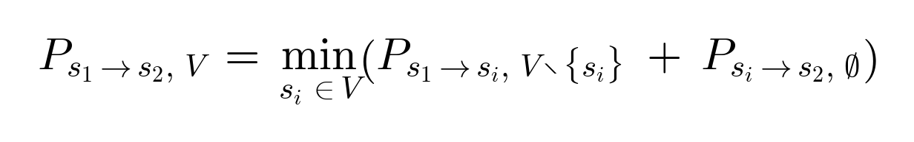
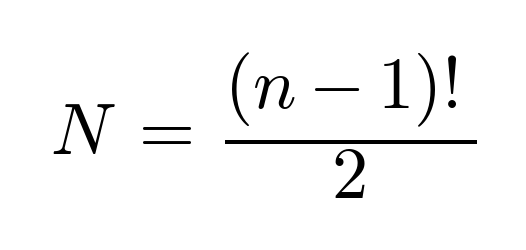
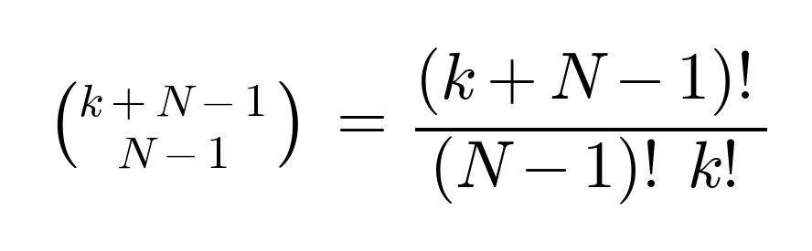
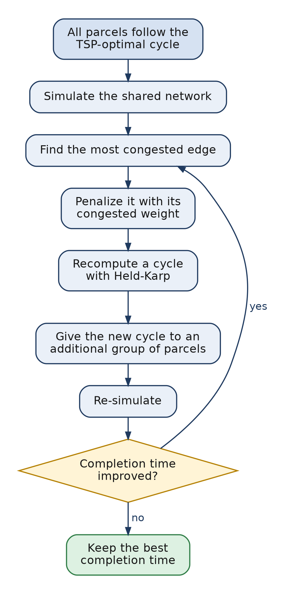
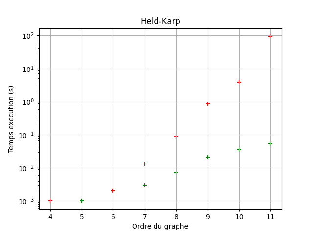
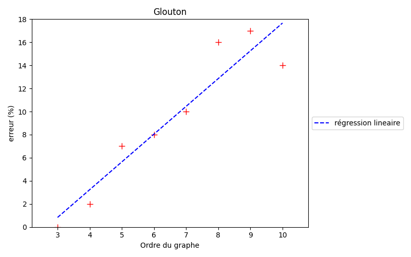
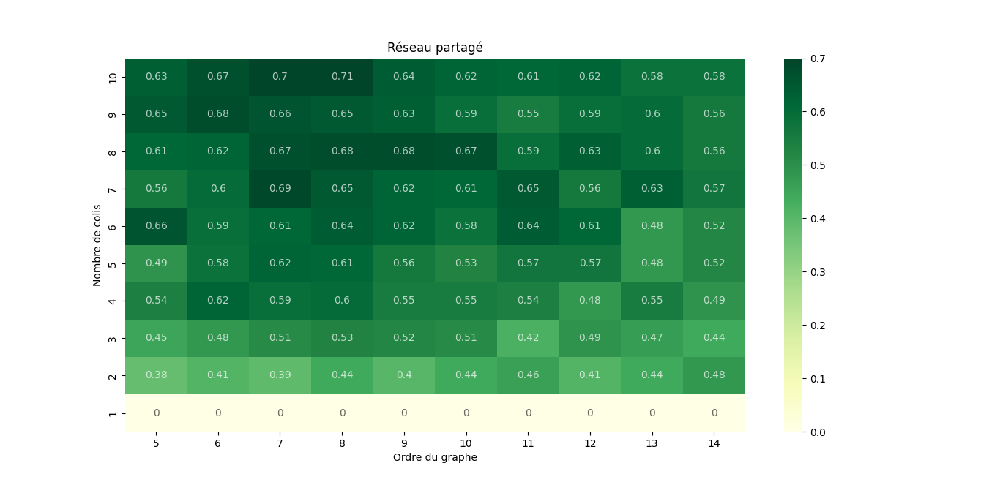

# Extension of the Traveling Salesman Problem for Collective Optimization

Research project (TIPE) carried out in the French *classes préparatoires* (CPGE MP/MPI, Lycée Carnot, Dijon), 2025–2026.
**Author:** Romain Lo Bello

> How can the total processing time of parcels in a factory or warehouse be reduced when several parcels travel through the same network at the same time and slow each other down?

This project models the routing of parcels as a Traveling Salesman Problem (TSP), implements and compares three solvers (brute force, greedy heuristic, Held-Karp dynamic programming), then extends the model to a shared network where simultaneous parcels create congestion. An iterative algorithm combining simulation and re-routing is proposed and evaluated on randomly generated graphs.

The original presentation (in French) is available in [`docs/`](docs/).

## Contents

- [Key results](#key-results)
- [1. TSP solvers](#1-tsp-solvers)
- [2. Extension to a shared network](#2-extension-to-a-shared-network)
- [3. Results](#3-results)
- [Limitations](#limitations)
- [Repository structure](#repository-structure)
- [References](#references)

## Key results

| | |
|---|---|
| Exact solver | Held-Karp dynamic programming, benchmarked up to 18 nodes |
| Greedy heuristic | Fast (O(n^2)), but with an error growing with graph size (up to about 17 % on the tested graphs) |
| Shared-network algorithm | Time gain over the baseline method between about 0.38 and 0.71 for 2 to 10 parcels (graphs of 5 to 14 nodes) |

## 1. TSP solvers

The network is a weighted graph, stored as an adjacency matrix. A parcel must visit every node and come back to its starting point: the goal is a minimum-weight Hamiltonian cycle.

| Algorithm | Type | Complexity | Notes |
|---|---|---|---|
| Brute force | Exact | O(n × n!) | Tries every cycle; impractical beyond about 10–11 nodes |
| Greedy (nearest neighbor) | Heuristic | O(n^2) | Local choices; can be far from optimal (cost 13 vs 6 on a 4-node counter-example) |
| Held-Karp | Exact | O(n^2 × 2^n) | Dynamic programming over subsets of nodes |

Held-Karp relies on the recurrence below, where P(s1 → s2, V) is the minimum weight of a path from s1 to s2 that goes through all the nodes of the set V:



In words: to find the best path from s1 to s2 through V, try every node si of V as the last stop before s2. For each choice, take the best path from s1 to si through the remaining nodes (V without si), add the edge from si to s2, and keep the smallest total. Results for every subset are stored, so each subproblem is solved only once.

**Benchmarks.** On the same random graphs, Held-Karp is orders of magnitude faster than brute force: at 11 nodes, brute force takes on the order of 100 s whereas Held-Karp stays below 0.1 s. Held-Karp was then run up to 18 nodes (a few tens of seconds at most).

## 2. Extension to a shared network

### Model

- k parcels travel through the same graph, each following a cycle.
- Time is discrete. An edge of base weight w crossed simultaneously by m parcels takes w + m − 1 time units to cross: its base weight, plus one extra time unit for each additional parcel.
- The total completion time is the time at which the last parcel finishes its cycle.

If every parcel follows the same optimal cycle, they all pile up on the same edges. The question is whether giving different parcels different cycles reduces the total time.

### Why not enumerate every assignment?

A graph with n nodes has N possible Hamiltonian cycles:



Distributing k parcels among these N cycles gives the following number of scenarios to simulate:



This number explodes very quickly with the graph size and the number of parcels. The project therefore uses an iterative heuristic instead of an exhaustive search.

### Algorithm



## 3. Results

The experiments were run on randomly generated graphs (each edge exists with probability 0.6, with random integer weights), for graphs of 5 to 14 nodes and 1 to 10 parcels.

Performance comparison between the Held-Karp algorithm (green) and brute force (red): the x-axis represents the order of the graph (number of vertices $n$) and the y-axis the execution time to find the exact solution, illustrating the gap between an $O(n^2 2^n)$ complexity and a factorial $O(n!)$ complexity.



Percentage error of the greedy algorithm relative to the exact solution as a function of graph order, where the y-axis represents the relative excess weight compared to the optimal path.



**Shared network.** The heatmap below shows the time gain obtained by the algorithm compared with the baseline method (all parcels following the same TSP-optimal cycle), as a function of the graph order and the number of parcels:



- x-axis is the graph order, y-axis is the  number of parcel
- With a single parcel there is nothing to share, so the gain is 0.
- With 2 or more parcels the gain is positive, between about 0.38 and 0.71.
- The gain tends to increase with the number of parcels.

## Limitations

- Experiments use small, synthetic graphs (up to 14 nodes for the shared network, 18 for the exact solver), not real factory data.
- The shared-network algorithm is a **heuristic**: it gives no optimality guarantee, and results depend on the congestion model chosen here.
- The model is simplified: discrete time, and congestion modeled only through edge weights.
- This is a student research project: it has not been peer-reviewed.

Possible extensions: other congestion models, distinguishing parcels (priorities, deadlines), larger graphs with metaheuristics, and validation on real data.

## Repository structure

```
.
├── README.md
├── src/
│   ├── tsp_algorithms.py      
│   ├── graph_generation.py    
│   ├── simulation.py          
│   ├── main.py                 
│   └── shared_network.py     
└── docs/
    ├── presentation_fr.pdf    # original TIPE presentation (French)
    └── figures/
```


## References

- M. Held and R. M. Karp, *A Dynamic Programming Approach to Sequencing Problems*, Journal of the Society for Industrial and Applied Mathematics, 10(1), 1962.
- R. Bellman, *Dynamic Programming Treatment of the Travelling Salesman Problem*, Journal of the ACM, 9(1), 1962.
- TUM, [TSP game](https://algorithms.discrete.ma.tum.de/graph-games/tsp-game/index_en.html), used for the introductory illustration.
